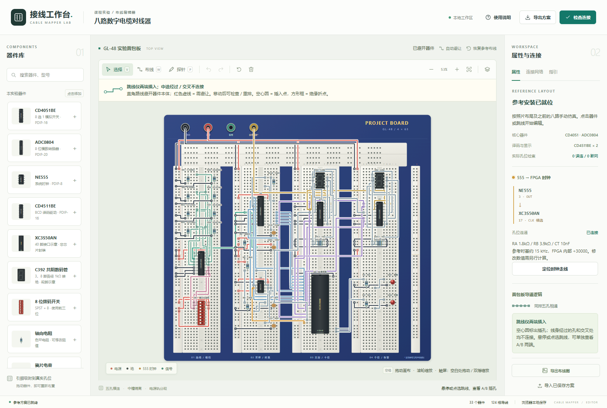

# 面包板接线工作台

一个可离线运行的八路数字电缆对线器布线编辑器。以 GL-48 类实验面包板为底座，支持放置器件、调整跳线、查看孔位导通，并检查器件本体对走线的遮挡。

[下载单文件离线版](https://github.com/xuxux333/cable-breadboard-lab/releases/latest/download/cable-breadboard-lab.html) · [v0.3.1 源码与离线包](https://github.com/xuxux333/cable-breadboard-lab/releases/tag/v0.3.1)

当前版本 **v0.3.1**。Release 提供可直接打开的离线 HTML、完整源码 ZIP 和 SHA256 校验清单，也可按下方命令自行构建。

此次修改的依据、已确认问题和保留的实物条件见 [核查意见处理说明](docs/audit-response.md)。



## 快速使用

下载仓库后，直接用浏览器打开 `dist/index.html`，保留同目录文件即可使用，无需联网、安装依赖或登录。

如果浏览器限制本地文件，可安装 [Node.js](https://nodejs.org/) 22 或更高版本，在项目目录执行：

```sh
npm start
```

然后打开终端显示的 `http://127.0.0.1:4173`。服务仅监听本机；可用 `npm start -- 8080` 修改端口。

生成便于携带的单个离线 HTML：

```sh
npm run build
```

双击生成的 `release/cable-breadboard-lab.html` 即可打开。全部样式、逻辑和 SVG 图形均已内嵌，运行时无需外部资源；原厂资料链接仅在主动点击时访问网络。

制作完整源码与离线包：

```sh
npm run release
```

`release/` 中会生成离线 HTML、带顶层目录的版本 ZIP 和 `SHA256SUMS.txt`。构建统一使用 LF 行尾；同一份源码在 Windows/Linux 下应得到相同产物。此命令只生成本地文件，不会自动上传或发布。

## 编辑与检查

- 从左侧器件库添加器件；拖动时检查所有引脚能否入孔，找不到可安装位置会保留原位。按 `R` 旋转、`Delete` 删除，`Ctrl+Z` 撤销。芯片、数码管、拨码和 FPGA 示意只允许 0°/180° 安装。
- `V` 选择、`W` 布线、`P` 探针、`F` 适合画布；空格拖动画布，滚轮缩放。触屏可拖动空白处平移、双指缩放；`Ctrl`/`Cmd`/`Alt` 组合保留浏览器原有行为（撤销/重做除外）。
- 每根跳线仅 A、B 两端插入。空心圆标出端点，选中或悬停时显示完整孔号。经过的孔、绝缘折点和交叉位置不会额外导通。
- 拖动导线端点和折点；双击线段增加折点，双击方形折点删除。
- 布线时点击 A 起点孔、空白处的绝缘折点，再点击 B 终点孔；按住 `Alt` 点击可强制添加折点。折点没有电气连接。
- “自动避让”绕开芯片、数码管、拨码开关、阻容及 LED 的本体。手动调整后的冲突会标红，可单独或整体重排。
- “探针”查看实际导通组，“检查连接”分别显示电气连接问题与布线冲突。
- 方案在浏览器本地保存；“导出方案”保存可再次导入的 JSON，“导出布线图”保存自包含 SVG，移除选择框、探针、冲突标记和网络淡化等编辑状态。重要修改建议另行导出备份。

器件移动后，插在面包板孔位上的跳线仍留在原孔；需要重新检查并调整连接。

## 面包板逻辑

模型包含四个主接线区，每区 63 行。每行同侧五孔导通，中央槽左右隔离，不同行互不相连。正负电源轨相互独立，竖向电源轨按上下两段建模，顶部横向电源条按左右两段建模；跨段供电必须显式加跳线。接线柱也需跳线接入电源轨。

默认方案只使用前四组竖向电源轨。最右侧第五组竖轨和四条顶部电源条没有接入电源；外观上的正负号不代表已经供电。

五孔组之间的外观间距不会把同一半段电源轨切断。电阻、电容、LED 和芯片不被当作导线直接短接。模型对电源轨分段采取明确假设，实物铜片结构需用万用表确认。

## 参考电路与实物限制

默认方案包含 **33 个器件、124 根跳线、60 个参考网络**，沿用约 15 kHz 单 NE555 时钟和八路手动选线结构：

- 译码器为两片 **CD4511BE**，器件示意参考原厂 PDIP 封装和引脚。
- **555 的 3 脚 OUT 已连接到 FPGA 示意接口 17**，作为 FPGA 时钟输入。
- 每只数码管的 **3、8 脚各串联一只 1 kΩ 电阻接地**；两只数码管共四只。4511 的 a–g 输出直接连接显示段，按该课程已确认接法建模。
- XC3S50AN 采用用户需求中的 **40 脚开发板接口示意**，并非真实芯片封装；接口 17 不等于封装 P17，其余信号的实物接口映射尚未确认。
- 数码管其余段脚、供电、电源轨结构、5 V 外设与 FPGA 的输入阈值和耐压、所需电平转换，均须根据实物资料核对。
- 拨码 OFF 时不会自动输出低电平。当前方案没有补入未经确认的偏置电阻；实物搭建必须先落实地址输入的偏置接法，否则 CD4051 选通可能不确定。
- ADC0804 的 10 kΩ 时钟电阻跨接 4/19 脚，150 pF 电容从 4 脚 CLK IN 接地，依据 [TI 手册 Figure 35](https://www.ti.com/lit/ds/symlink/adc0804-n.pdf#page=27)。VREF/2 悬空是手册允许的参考方式；当前按 VCC = 5 V、约 0–5 V 量程规划，实物需用已知电压验证（例如输入 2.500 V 时检查原始码是否接近 128）。
- NE555 输出高电平随供电、负载和器件差异变化。[TI 电气特性表](https://www.ti.com/lit/ds/symlink/ne555.pdf)里的 3.3 V 典型值带有具体负载条件，不能作为轻载上限或直接接 FPGA 的保证。ADC 数据输出、555 时钟、4511 输入门限应分别核对。
- 公共阴极限流方式沿用课程确认接法；不同点亮段数下的亮度、CD4511 输出电流和温升仍需实测。

这里的连接检查用于布线规划与教学，不等同于模拟电路仿真、FPGA 时序验证或实物通电验收。避让检查依据器件俯视本体和约 6 个绘图单位的间隙，不模拟三维线高、真实线长、弯曲半径或线束拥挤。交叉线按绝缘跳线处理。

检查器根据器件上分配的网络判断是否导通，不判断信号是否有驱动、输入是否偏置或复位时序是否有效。单端点网络（例如 `rst_n`）没有“另一端”可比较，显示网络导通不能据此认定输入电平正确。

旧版保存方案会尝试升级显示模块和走线，升级前保留浏览器本地备份；无法找到可用孔位时会提示手动处理。损坏或不兼容的本地存档会先保留备份并提示；保存失败时请导出 JSON。备份存于当前浏览器，换浏览器或移动离线 HTML 的位置不保证能读到原存档。

## 开发与验证

项目使用原生 HTML、CSS、JavaScript 和 Node.js 内置模块，无第三方运行时依赖，无需执行 `npm install`。

```sh
npm test
npm run build
```

测试覆盖五孔导通、中槽与电源轨隔离、端点连接、导线交叉、555 时钟、数码管公共脚限流、旧方案迁移、器件避让、导入校验、安装姿态及构建完整性。新增 `tests/*.test.cjs` 会自动纳入。GitHub Actions 在 Node.js 22 上运行测试和离线构建。

```text
dist/                可直接打开的浏览器应用源码
tests/               电气、升级和布线测试及旧版方案样本
scripts/             单文件离线构建与本地静态服务
docs/circuit-reference.json  参考器件和网络文档，不随离线版加载
docs/screenshot.png  应用界面截图
```

## 许可与资料

代码与项目文档采用 [MIT License](LICENSE)。原厂手册仅链接，不随仓库分发；课程 PPT、内部工程及用户实物照片均未公开。详见 [第三方资料与商标说明](THIRD_PARTY_NOTICES.md)。
